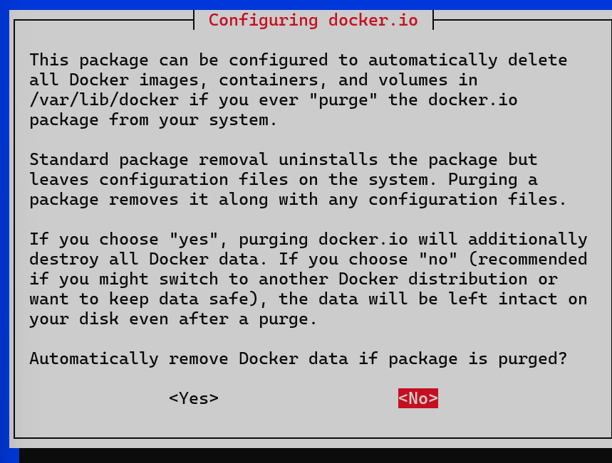

# sus_BC2

`injectived` の接続設定・CLI 操作については、[docs/injective-setup.md](docs/injective-setup.md) を参照する。

## 実行手順

本リポジトリの利用者は、次の順番で作業する。

1. Windows で作業する場合は、WSL を更新し、Kali Linux をインストールする。
2. 本リポジトリをクローンする。
3. リポジトリルートで実験用の環境構築スクリプトを実行する。

以降のコマンドは、特に指定がない限り、Kali Linux のターミナルで実行する。

### 1. WSL を更新し、Kali Linux をインストールする

Windows で作業する場合は、Windows の PowerShell またはコマンドプロンプトを管理者権限で開き、最初に次のコマンドで WSL を更新する。

```powershell
wsl --update
```

更新が完了した後、次のコマンドで WSL 上に Kali Linux をインストールする。

```powershell
wsl --install -d kali-linux
```

更新またはインストール時に再起動を求められた場合は、Windows を再起動してから次の操作に進む。詳しくは [Microsoft の WSL 基本コマンド](https://learn.microsoft.com/ja-jp/windows/wsl/basic-commands) と [WSL インストール手順](https://learn.microsoft.com/ja-jp/windows/wsl/install) を参照する。

Kali Linux の初回起動時に、Linux 用のユーザー名とパスワードを作成してから次の手順に進む。詳しくは、後述の「補足：初期設定と一括セットアップの内容」を参照する。

### 2. リポジトリをクローンする

Git が未インストールの場合は、Kali Linux のターミナルで先に次のコマンドを実行する。
これはリポジトリ取得前の準備であり、取得後の環境構築は手順 3 のスクリプトで行う。

```bash
sudo apt update
sudo apt install -y git
```

本リポジトリを `~/temp/sus_BC2` にクローンする。

```bash
mkdir -p ~/temp
cd ~/temp
git clone https://github.com/yanagihalab/sus_BC2
cd sus_BC2
```

### 3. 環境構築スクリプトを実行する

リポジトリルートで、次のコマンドを実行する。先頭の `bash` を指定し、一括セットアップスクリプトを Bash で実行する。

```bash
cd ~/temp/sus_BC2
bash ./setup/normal/wsl-kali-experiment-env.sh
```

このスクリプトを実行すると、標準設定ではリポジトリルートに `venv` という名前の Python 仮想環境（`~/temp/sus_BC2/venv/`）が作成され、必要なライブラリがインストールされる。

実行中に `Configuring docker.io` の確認画面が表示された場合は、画面下部の **`<No>` を選択して `Enter` を押す**。詳しくは、折りたたみ補足の「Docker パッケージの確認画面での操作」を参照する。

<details>
<summary>補足：一括セットアップの処理順序</summary>

`wsl-kali-experiment-env.sh` は、次の順序で処理を実行する。標準設定では SSH サーバーの設定以外をすべて行う。
各処理のコマンドと役割は、次の「補足：初期設定と一括セットアップの内容」を参照する。

| 順序 | 処理 | 内容 |
| --- | --- | --- |
| 1 | 設定・実行条件の確認 | 各 `SETUP_*` の値、リポジトリ、`requirements.txt`、Visualizer の `package.json` を確認する。標準設定は x86_64 向けで、CW20 をビルドする場合は Docker の導入も有効にする。作業先と各パスを設定し、WSL 上での実行かを確認する。WSL ではない場合は警告を表示する。 |
| 2 | Kali の更新とパッケージの導入 | `00-install-kali-packages.sh` で、APT のパッケージ一覧更新、インストール済みパッケージの更新、必要なパッケージの事前ダウンロード、インストールを順に実行する。事前取得の HTTP 500・502・503・504 は回数を限って再試行する。基本ツールに加え、`SETUP_DOCKER=yes` では `docker.io`、`SETUP_SSH=yes` では `openssh-server` を同じ install 処理で導入する。Node.js が 20 以上であることと各ツールのバージョンを確認する。 |
| 3 | Python 仮想環境の作成 | リポジトリ直下に `venv/` を作成し、その環境に `requirements.txt` の `requests`、`numpy`、`scipy`、`tqdm`、`pandas`、`matplotlib` を導入する。作成先は `VENV_DIR` で変更できる。 |
| 4 | Visualizer の依存パッケージの導入 | `08-setup-proposer-visualizer.sh` で、`Day1/Proposer-visualizer` 内の `npm install` を実行する。Visualizer の起動は別途行う。 |
| 5 | SSH サーバーの設定（任意） | `SETUP_SSH=yes` の場合だけ、`02-setup-vscode-ssh.sh` を実行する。処理順序の 2 で導入した OpenSSH の標準ポートを `2222` に設定する。パスワード認証を有効、root ログインを無効にし、SSH サービスを再起動する。 |
| 6 | SimBlock の取得とビルド | `03-install-simblock.sh` で、導入済みのツールを確認し、SimBlock のリポジトリがなければ取得する。Java 11 の JDK を選択し、Gradle の `clean` と `build` を実行する。シミュレーションの実行は別途行う。 |
| 7 | ブロックチェーン実験用 CLI の準備 | 一括セットアップで CLI を準備する。設定・操作は [docs/injective-setup.md](docs/injective-setup.md) を参照する。 |
| 8 | Docker Engine の起動と確認 | `09-install-docker.sh` で、処理順序の 2 で導入した Docker のサービスを起動してバージョンを確認する。標準設定では Docker グループへのユーザー追加を省略し、`hello-world` も実行しない。 |
| 9 | CW20 サンプルの WASM ビルド | `10-build-cw20-sample.sh` で Docker への接続を確認し、必要に応じて `sudo docker` を使う。`cw-plus` のリポジトリがなければ `--depth 1` で取得し、`cosmwasm/workspace-optimizer:0.17.0` に `./contracts/cw20-base` を指定してビルドする。古い WASM とチェックサムを削除してから、生成された `cw-plus/artifacts/cw20_base.wasm` が空でないこととチェックサムを確認する。 |
| 10 | 完了メッセージと操作方法の表示 | リポジトリ、仮想環境、外部リポジトリ・ダウンロードの保存先を表示し、仮想環境を有効にするコマンドや、SSH 設定・各機能の省略方法を案内する。標準の外部リポジトリ・ダウンロード先はリポジトリの親ディレクトリ（本書の配置では `~/temp`）である。 |

Visualizer、SimBlock、Docker、CW20 は、対応する `SETUP_*` に `no` を指定すると省略できる。Docker を省略する場合は `SETUP_DOCKER=no SETUP_CW20=no` を指定する。
主要な導入・ビルド処理が失敗すると、後続の処理を実行せず停止する。途中までの変更は自動では巻き戻さない。

仮想環境は自動作成されるが、現在のターミナルで有効にするには、完了後に次を実行する。

```bash
cd ~/temp/sus_BC2
source venv/bin/activate
```

WSL 本体の更新と Kali Linux のインストールは、スクリプト実行前に Windows 側で行う。
一括セットアップ後のブロックチェーン操作は、[docs/injective-setup.md](docs/injective-setup.md) に従って行う。

</details>

<details>
<summary>補足：初期設定と一括セットアップの内容</summary>

#### 一括セットアップの対象と処理内容

標準セットアップは x86_64 版 Kali Linux を対象とする。
本書で紹介する環境構築スクリプトのコマンドは、特に指定がない限り、リポジトリルートから実行する。
環境構築は、このスクリプトの実行に集約している。標準の設定で、次の処理を順に行う。
APT による更新とパッケージ導入は `00-install-kali-packages.sh` にまとめている。`02`、`03`、`04`、`09` の個別スクリプトは、導入済みのパッケージを使って設定・取得・ビルド・起動を行う。
以下の補足では、スクリプト内で実行するコマンドとその役割を示す。通常の準備には主手順 3 を使い、補足は各処理を理解するために参照する。
コマンド例は、リポジトリを `~/temp/sus_BC2` に配置した場合の標準パスで記載している。`WORKDIR`、`VENV_DIR`、`APP_DIR` などを変更した場合は、指定したパスに読み替える。
一括セットアップは `set -euo pipefail` により、主要な処理の失敗や未設定変数の参照を検出して停止する。以下のコードブロックは、処理ごとの説明である。

| 対象 | セットアップ内容 |
| --- | --- |
| Kali Linux | パッケージ情報・インストール済みパッケージの更新 |
| 基本ツール | Python、Java 11、Node.js、npm、Git、curl、unzip、jq、Bash、CA 証明書、SSH クライアント、wget の導入 |
| Python | `venv` という名前の仮想環境の作成と `requirements.txt` のライブラリの導入 |
| Proposer Visualizer | Node.js 20 以降の確認と npm 依存パッケージの導入 |
| SimBlock | ソースコードの取得と Java 11 によるビルド |
| 実験用 CLI | 一括セットアップで準備。設定・操作は [docs/injective-setup.md](docs/injective-setup.md) を参照 |
| Docker / CW20 | `00` で Docker を導入し、`09` で起動。CW20 サンプルの取得と `cw20-base` の WASM ビルド |

完了後は、後述の各項目に従って仮想環境の有効化、アプリの起動、実験を行う。

#### Kali Linux の初期設定

インストール後に Kali Linux が起動したら、Linux 用のユーザー名とパスワードを作成する。
パスワードの入力中は画面に文字が表示されないが、実際には入力されている。
この初回設定は、環境構築スクリプトを実行する前に済ませる。

#### Kali のパッケージを更新し、基本ツールを導入する（Bash で実行）

リポジトリ取得後、パッケージの更新と基本ツールの導入を個別に行う場合は、Kali Linux のターミナルで次を実行する。

```bash
cd ~/temp/sus_BC2
bash ./setup/normal/00-install-kali-packages.sh
```

先頭の `bash` で実行するシェルを明示しているため、現在のターミナルが Zsh でも、このスクリプトは Bash で実行される。
パッケージ一覧の更新、インストール済みパッケージの更新、基本ツールの導入、各ツールのバージョン確認を順に行う。標準設定では Docker も導入する。
この処理は、主手順 3 の一括セットアップにも含まれる。以下では、スクリプト内のコマンドと役割を説明する。

#### Kali Linux の更新

一括セットアップでは、次のコマンドを実行する。

```bash
sudo apt-get --error-on=any -o Acquire::Retries=5 update
sudo apt-get -o Acquire::Retries=5 --with-new-pkgs upgrade -y
```

`apt-get update` は、利用可能なパッケージとバージョンの一覧を更新する。`--error-on=any` は、更新中にエラーがあった場合に失敗として扱う指定である。
`apt-get upgrade` は、その一覧を使ってインストール済みパッケージを更新する。`--with-new-pkgs` は更新に必要な新規パッケージの導入を許可し、`-y` は確認への応答を自動化する。
`-o Acquire::Retries=5` は、このコマンドのダウンロード再試行回数を 5 回に設定する。
`00-install-kali-packages.sh` 内の APT 処理が失敗した場合は、元の出力に加えて処理段階、スクリプトと行番号、実行コマンド、終了コードを表示し、後続の処理を停止する。
update と upgrade は各1回実行し、失敗した場合はその時点で停止する。以降の基本ツールの事前取得だけに、HTTP エラー用の再試行処理を設けている。

#### 基本ツールのインストール

基本ツールと、指定した機能に必要なパッケージを配列にまとめ、事前にダウンロードしてから1回の install 処理で導入する。
`SETUP_DOCKER` の既定値は `yes`、`SETUP_SSH` の既定値は `no` である。一括セットアップの入口は、この2つの指定を `00-install-kali-packages.sh` に渡す。
`00-install-kali-packages.sh` は、両方の値が `yes` または `no` であることを確認し、それ以外の場合は APT の実行前に停止する。

```bash
SETUP_DOCKER="${SETUP_DOCKER:-yes}"
SETUP_SSH="${SETUP_SSH:-no}"
PACKAGES=(
  python3-pip python3-venv openjdk-11-jdk
  unzip npm jq git curl nodejs
  bash ca-certificates openssh-client wget
)
if [ "$SETUP_DOCKER" = "yes" ]; then
  PACKAGES+=(docker.io)
fi
if [ "$SETUP_SSH" = "yes" ]; then
  PACKAGES+=(openssh-server)
fi
sudo apt-get -o Acquire::Retries=5 --download-only install -y "${PACKAGES[@]}"
sudo apt-get -o Acquire::Retries=5 install -y "${PACKAGES[@]}"
```

配列の順序は基本ツール、Docker、SSH サーバーの順である。`"${PACKAGES[@]}"` は、配列の各要素を別々の引数として渡す。
`--download-only` は取得だけを行い、パッケージの展開・インストールは行わない。取得に成功してから通常の install を実行する。[APT の公式マニュアル](https://manpages.debian.org/trixie/apt/apt-get.8.en.html)も参照できる。
事前取得が終了コード `100` で失敗し、取得エラーが HTTP `500`・`502`・`503`・`504` だけの場合は、10秒待って同じ取得コマンドを再実行する。既定では初回を含め最大3回試す。取得済みのキャッシュは削除しない。
404、署名・依存関係など別のエラーが混在する場合は再試行せず停止する。インストール処理自体も自動では繰り返さない。パッケージ設定の確認画面は通常の install 時に操作する。
`APT_HTTP_MAX_ATTEMPTS`（正の整数、既定 `3`）と `APT_HTTP_RETRY_DELAY`（秒、非負整数、既定 `10`）で事前取得の試行回数と待機時間を指定できる。`Acquire::Retries=5` は各 APT コマンド内の取得再試行であり、この上限とは別である。

| パッケージ | 用途 |
| --- | --- |
| `python3-pip` / `python3-venv` | Python ライブラリの管理と仮想環境の作成 |
| `openjdk-11-jdk` | SimBlock のビルドと実行 |
| `nodejs` / `npm` | Visualizer の依存パッケージの導入と起動 |
| `git` / `curl` / `wget` / `unzip` | ソースコード・配布ファイルの取得と展開 |
| `jq` | JSON の表示・確認 |
| `bash` | セットアップスクリプトの実行 |
| `ca-certificates` | HTTPS 通信に使う CA 証明書 |
| `openssh-client` | SSH クライアント |
| `docker.io` | Docker Engine。`SETUP_DOCKER=yes` の場合に導入 |
| `openssh-server` | SSH サーバー。`SETUP_SSH=yes` の場合に導入 |

各スクリプトを個別に実行する場合も、先に `bash ./setup/normal/00-install-kali-packages.sh` を実行して必要なパッケージを導入する。SSH サーバーの個別設定には、後述の `SETUP_SSH=yes` を使う準備が必要である。

スクリプトは Node.js のメジャーバージョンを確認し、20 未満の場合は停止する。
導入後、次のコマンドで各ツールのバージョンを確認する。

```bash
python3 --version
git --version
java -version
node --version
npm --version
jq --version
```

#### Docker パッケージの確認画面での操作

`wsl-kali-experiment-env.sh` の実行中、`00-install-kali-packages.sh` によるパッケージの導入・更新で、次の `Configuring docker.io` の確認画面が表示されることがある。
APT の `-y` を指定していても、パッケージ設定の確認画面では入力が必要になる場合がある。



上の画像では `<No>` が選択されているため、そのまま `Enter` キーを押して進む。

```text
Configuring docker.io
Automatically remove Docker data if package is purged?
<Yes>    <No>
```

この画面では、次の操作で進む。

1. 画面下部の **`<No>`** を選択する。`<Yes>` が選択されている場合は、`Tab` キーで `<No>` に切り替える。
2. **`Enter` キー**を押して確定する。すでに `<No>` が選択されている場合は、そのまま `Enter` を押す。
3. 確認画面が閉じ、パッケージの導入・更新が再開するので、そのまま完了を待つ。

これは、将来 `docker.io` パッケージを `purge`（設定ファイルも含めた削除）したときに、`/var/lib/docker` にある Docker のイメージ・コンテナ・ボリュームも自動削除するかを決める設定である。
`No` は、そのときも Docker のデータを残す設定であり、この実験手順では `No` を選ぶ。`Yes` は、将来の `purge` 時に Docker のデータも削除する設定になる。
この画面で確定した時点で、Docker のデータが削除されるわけではない。

#### Python 仮想環境（venv）の作成と利用

`venv` は、実験で使う Python とライブラリをプロジェクトごとに管理するための仮想環境である。
`wsl-kali-experiment-env.sh` を実行すると、標準設定でリポジトリ内の `venv/` にこの環境が自動作成される。[Python の venv ドキュメント](https://docs.python.org/ja/3/library/venv.html) も参照できる。

```bash
cd ~/temp/sus_BC2
python3 -m venv venv
venv/bin/python -m pip install -r requirements.txt
```

`python3 -m venv venv` は、Python に付属する `venv` モジュールを使い、最後の引数で指定した `venv/` ディレクトリに仮想環境を作成する。
作成後は、`venv/bin/python` がこの環境の Python 実行ファイルとなる。

`venv/bin/python -m pip install -r requirements.txt` は、仮想環境の Python で `pip` を実行し、`requirements.txt` に記載されたライブラリをその環境へインストールする。
一括セットアップも、このように仮想環境の Python を直接指定してライブラリを導入する。

実験を始めるときは、現在のターミナルで仮想環境を有効にする。

```bash
cd ~/temp/sus_BC2
source venv/bin/activate
python --version
python -m pip list
```

`source venv/bin/activate` は、現在のシェルの `PATH` を変更し、`python` や `pip` が仮想環境内の実行ファイルを参照するようにする。
スクリプトの子プロセス内の設定は、実行元のターミナルには引き継がれないため、一括セットアップ後にもこの有効化が必要である。
`python -m pip list` は、仮想環境にインストールされたライブラリを確認するコマンドである。

実験を終えて仮想環境の利用を解除するときは、次を実行する。作成した `venv/` は残るため、次回も `source` で有効化できる。

```bash
deactivate
```

#### Proposer Visualizer の依存パッケージの導入

Node.js と npm を導入した後、アプリのディレクトリで次を実行する。

```bash
cd ~/temp/sus_BC2/Day1/Proposer-visualizer
npm install
```

`npm install` は、`package.json` とロックファイルに基づいて必要なパッケージを `node_modules/` に導入する。
一括セットアップは依存パッケージの準備までを行い、アプリの起動は後述の `npm run start` で行う。
`RESET_NODE_MODULES=yes` を指定した場合だけ、インストール前に次の削除処理を行い、依存パッケージとロックファイルを作り直す。

```bash
rm -rf node_modules package-lock.json
```

#### SimBlock の取得とビルド

`00-install-kali-packages.sh` で導入した Java 11 と取得に必要なツールを確認し、SimBlock のリポジトリがない場合にクローンする。

```bash
mkdir -p ~/temp
if [ ! -d ~/temp/simblock/.git ]; then
  git clone https://github.com/dsg-titech/simblock ~/temp/simblock
fi
```

`.git` の存在確認は、取得済みのソースコードを再度クローンしないための処理である。
次に、Java 11 の JDK を選ぶ。既存の `JAVA_HOME` が Java 11 の JDK を指している場合はその値を使い、それ以外はインストール先から選び直す。
`java` と `javac` の存在、および Java のバージョンを確認する処理は次のとおりである。

```bash
is_java11_jdk() {
  local jdk_dir="$1"
  local version
  [ -n "$jdk_dir" ] && [ -x "$jdk_dir/bin/java" ] && [ -x "$jdk_dir/bin/javac" ] || return 1
  version="$("$jdk_dir/bin/java" -version 2>&1)" || return 1
  [[ "$version" == *'version "11.'* || "$version" == *'version "11"'* ]]
}

if ! is_java11_jdk "${JAVA_HOME:-}"; then
  JAVA_HOME=""
  while IFS= read -r candidate; do
    if is_java11_jdk "$candidate"; then
      JAVA_HOME="$candidate"
      break
    fi
  done < <(find /usr/lib/jvm -maxdepth 1 -type d -name 'java-11-openjdk-*' | sort)
fi

if [ -z "$JAVA_HOME" ]; then
  echo "Java 11 JDK が見つかりません" >&2
  exit 1
fi

export JAVA_HOME
export PATH="$JAVA_HOME/bin:$PATH"
cd ~/temp/simblock
chmod +x gradlew
bash ./gradlew clean
bash ./gradlew build
```

`JAVA_HOME` は使用する JDK の場所を指定し、`PATH` の先頭へその `bin/` を追加することで Java 11 を選択する。
`chmod +x gradlew` は Gradle Wrapper に実行権限を付ける。
`clean` は前回のビルド出力を削除し、`build` はソースコードをビルドする。
SimBlock のシミュレーション実行は、後述の `bash ./gradlew :simulator:run` で行う。

#### Docker の起動と確認

Docker Engine のパッケージ導入は `00-install-kali-packages.sh` で完了している。ここではサービスを起動する。

```bash
if command -v systemctl >/dev/null 2>&1; then
  sudo systemctl enable docker || true
  sudo systemctl start docker || sudo service docker start
else
  sudo service docker start
fi
sudo docker --version
```

`systemctl enable` はサービスの自動起動を設定し、`systemctl start` は現在のサービスを起動する。
`systemctl` が使えない場合や起動に失敗した場合は、`service docker start` で起動する。
`ADD_USER_TO_DOCKER_GROUP=yes` を指定した場合だけ、次のコマンドで現在のユーザーを Docker グループへ追加する。

```bash
sudo usermod -aG docker "$USER"
```

グループ変更は、新しいシェルを開くか `newgrp docker` を実行して反映する。
CW20 のビルドでは、通常の Docker アクセスが使えない場合に `sudo docker` を選ぶため、標準セットアップの途中でグループ変更を反映する操作は不要である。

#### CW20 サンプルの取得と WASM のビルド

ビルド用の Docker を通常の権限で使えるか確認し、必要に応じて `sudo` で実行する。
`cw-plus` のワークスペース全体を `/code` に配置し、ビルド対象には `./contracts/cw20-base` を指定する。
ソースコード、`Cargo.toml`、`Cargo.lock`、依存パッケージは保持し、生成済みの `artifacts/*.wasm` と `artifacts/checksums.txt` を削除してからビルドする。

```bash
WORKDIR="${WORKDIR:-$HOME/temp}"
CW_PLUS_DIR="${CW_PLUS_DIR:-$WORKDIR/cw-plus}"
if ! command -v docker >/dev/null 2>&1; then
  echo "Docker がインストールされていません" >&2
  exit 1
fi
DOCKER=(docker)
if ! docker info >/dev/null 2>&1; then
  if command -v sudo >/dev/null 2>&1 && sudo docker info >/dev/null 2>&1; then
    DOCKER=(sudo docker)
  else
    echo "Docker Engine に接続できません" >&2
    exit 1
  fi
fi

mkdir -p "$WORKDIR"
if [ ! -d "$CW_PLUS_DIR/.git" ]; then
  git clone --depth 1 https://github.com/CosmWasm/cw-plus.git "$CW_PLUS_DIR"
fi
cd "$CW_PLUS_DIR"
if [ ! -f contracts/cw20-base/Cargo.toml ]; then
  echo "CW20 sample was not found: $CW_PLUS_DIR/contracts/cw20-base/Cargo.toml" >&2
  exit 1
fi

echo "Building only cw20-base; removing old WASM artifacts and checksums."
"${DOCKER[@]}" run --rm \
  --entrypoint /bin/sh \
  -v "$(pwd)":/code \
  --mount type=volume,source=cw20_base_cache,target=/target \
  --mount type=volume,source=registry_cache,target=/usr/local/cargo/registry \
  cosmwasm/workspace-optimizer:0.17.0 \
  -c '
    set -eu
    rm -f artifacts/*.wasm artifacts/checksums.txt
    exec /usr/local/bin/optimize.sh ./contracts/cw20-base
  '

if [ ! -s artifacts/cw20_base.wasm ]; then
  echo "CW20 build did not produce a non-empty WASM file: $CW_PLUS_DIR/artifacts/cw20_base.wasm" >&2
  exit 1
fi

ls -lh artifacts/cw20_base.wasm
ls -lh artifacts/checksums.txt
```

`docker info` は Docker Engine への接続確認である。
`git clone --depth 1` は、新規取得時の履歴を最新の1コミットに絞る。取得済みのリポジトリは再クローンしない。
`docker run --rm` はビルド用コンテナを起動し、終了時にコンテナを削除する。`--entrypoint /bin/sh` と `-c` で、生成物の削除とビルドを1回の Docker 実行にまとめる。
`-v` は `cw-plus` のルート全体を `/code` に対応させる。`cw20_base_cache` は中間ビルド成果物を `/target` に保持し、`registry_cache` は取得した Rust パッケージを `/usr/local/cargo/registry` に保持する。
`rm -f` の削除対象は生成済みの WASM とチェックサムであり、ソースコードや Cargo の設定・ロックファイル、依存パッケージは削除しない。`Cargo.lock` は依存関係の解決に使うため保持する。
`set -eu` は削除処理などが失敗した場合に停止する指定で、`exec` は同じシェルを optimizer に置き換え、その終了コードを返す。
[公式の optimize.sh v0.17.0](https://github.com/CosmWasm/rust-optimizer/blob/v0.17.0/optimize.sh) は、ビルド対象のディレクトリを1引数で受け取る。ここでは `./contracts/cw20-base` を指定し、ほかのコントラクトの WASM 生成を省く。
`-s` は生成された WASM が存在し、空でないことを確認する。`ls -lh` は `cw20_base.wasm` と `checksums.txt` の存在・サイズを確認するために使う。
初回は `cw20-base` が使う依存クレートやワークスペース内の依存パッケージの取得・コンパイルが必要である。

#### VS Code を SSH で接続する場合

通常は Remote - WSL を使用する。Remote - SSH を使用する場合は、一括セットアップ時に `SETUP_SSH=yes` を指定する。

```bash
cd ~/temp/sus_BC2
SETUP_SSH=yes bash ./setup/normal/wsl-kali-experiment-env.sh
```

この指定により、`00-install-kali-packages.sh` で `openssh-server` を導入し、その後 `02-setup-vscode-ssh.sh` で設定する。
SSH の設定スクリプトを個別に実行する場合は、先に次のコマンドでパッケージを準備する。

```bash
SETUP_SSH=yes bash ./setup/normal/00-install-kali-packages.sh
```

導入済みの SSH サーバーに対して行う設定は次のとおりである。

```bash
PORT="${PORT:-2222}"
SSHD_CONFIG="/etc/ssh/sshd_config"
sudo cp "$SSHD_CONFIG" "${SSHD_CONFIG}.bak.$(date +%Y%m%d%H%M%S)"

set_config() {
  local key="$1"
  local value="$2"
  if sudo grep -Eq "^[#[:space:]]*${key}[[:space:]]+" "$SSHD_CONFIG"; then
    sudo sed -i -E "s|^[#[:space:]]*${key}[[:space:]]+.*|${key} ${value}|" "$SSHD_CONFIG"
  else
    printf '%s %s\n' "$key" "$value" | sudo tee -a "$SSHD_CONFIG" >/dev/null
  fi
}

set_config "Port" "$PORT"
set_config "PasswordAuthentication" "yes"
set_config "PermitRootLogin" "no"
sudo service ssh restart
```

`cp` は変更前の設定を日時付きで保存する。`set_config` は既存の設定行を置換し、該当行がなければ追記する。
標準ポートは `2222` で、パスワード認証を有効にし、root のログインを無効にする。
`service ssh restart` は設定を反映するために SSH サーバーを再起動する。

</details>

## VS Code から Kali Linux を開く

VS Code から Kali Linux 内のファイルを編集する場合は、通常 `Remote - WSL` を利用する。
SSH 接続として追加したい場合は、`Remote - SSH` を利用する。

### Remote - WSL で開く

VS Code に WSL 拡張機能をインストールし、Kali Linux に接続する。
Kali Linux のターミナルから直接 VS Code を開く場合は、リポジトリのディレクトリで次のコマンドを実行する。

```bash
cd ~/temp/sus_BC2
code .
```

## Python 仮想環境の利用

主手順 3 で作成した Python 仮想環境を、現在のシェルで有効にする。

```bash
cd ~/temp/sus_BC2
source venv/bin/activate
```

一部の Python ファイルには、`*__*` のような未記入箇所がある。
対象チェーン、入力ファイル、試行回数、バリデータ数、ブロック数などを、実験条件に合わせて補完してから実行する。
未記入箇所が残っていると、構文エラーなどが発生することがある。

以降、各 Python スクリプトは、特に指定がない限り、仮想環境を有効にした状態でリポジトリルートから個別に実行する。
次のコマンドは各日の実行例である。

```bash
cd ~/temp/sus_BC2
python3 Day1/1-1_block-fetch.py
python3 Day2/2-1mm1_queue.py
python3 Day3/3-1_btc_mining.py
```

## SimBlock の実行

SimBlock は Day3 で使用する。ソースコードの取得とビルドは、主手順 3 の一括セットアップで完了する。
実験時は、現在のターミナルで Java 11 を選び、SimBlock に付属する Gradle Wrapper で実行する。

```bash
export JAVA_HOME="$(find /usr/lib/jvm -maxdepth 1 -type d -name 'java-11-openjdk-*' | sort | head -n 1)"
export PATH="$JAVA_HOME/bin:$PATH"
cd ~/temp/simblock
bash ./gradlew :simulator:run
```

## ブロックチェーン実験

`injectived` を使う CLI 操作は、[docs/injective-setup.md](docs/injective-setup.md) を参照する。
主手順 3 の環境構築後、同文書の手順に従って実験を進める。

## Proposer Visualizer の起動

Proposer Visualizer は、Day1 の実験で作成した提案者の系列（proposer sequence）を CSV ファイルから読み込み、ブラウザで可視化する Vite + React アプリである。
Node.js 20 以降、npm、アプリの依存パッケージは、主手順 3 の一括セットアップで導入済みとなる。
CSV ファイルは `Day1/Proposer-visualizer/out/` に配置する。サンプルとして `proposer_sequence.csv` を含めている。

```bash
cd ~/temp/sus_BC2/Day1/Proposer-visualizer
npm run start
```

`npm run start` は `public/out/` または `out/` 配下の CSV ファイルを列挙し、起動時に通常は同じディレクトリに `index.json`（マニフェスト）を生成してから Vite 開発サーバーを起動する。
起動後、ターミナルに表示される URL をブラウザで開く。
通常は `http://localhost:5173` で確認できる。

<details>
<summary>補足：Visualizer の起動時に実行するコマンド</summary>

`npm run start` は、マニフェストを生成する処理と、Vite 開発サーバーを起動する処理を順に実行する。
実際の処理をコマンドで表すと次のようになる。

```bash
cd ~/temp/sus_BC2/Day1/Proposer-visualizer
node scripts/gen-manifest.cjs &&
npm run dev -- --host 0.0.0.0 --port 5173
```

`node` は JavaScript のマニフェスト生成プログラムを実行する。
`&&` は前のコマンドが成功した場合だけ次を実行する指定である。
`--host 0.0.0.0` は WSL の外側からもアクセスできるように待受先を指定し、`--port 5173` は開発サーバーのポートを指定する。

</details>

マニフェストを生成済みの場合は、次のコマンドで Vite 開発サーバーのみを起動することもできる。

```bash
cd ~/temp/sus_BC2/Day1/Proposer-visualizer
npm run dev -- --host 0.0.0.0
```

`node_modules/`、ビルド出力、生成されたマニフェストは Git の管理対象外である。

## 困ったとき

### APT のパッケージ取得が HTTP 500 などで失敗する

`E: Failed to fetch ... 500 Internal Error` は、取得先または通信経路から HTTP エラーが返されたことを示す。終了コード `100` だけでは、APT のどの問題かは特定できない。
`00-install-kali-packages.sh` は、基本ツールの事前取得で上記の HTTP エラーが続くと、試行回数と失敗した段階を表示して停止する。

実行中のセットアップが終了し、プロンプトに戻ってから、時間を置いて同じオプションで再実行する。標準設定の場合は次を使う。

```bash
cd ~/temp/sus_BC2
bash ./setup/normal/wsl-kali-experiment-env.sh
setup_exit_code=$?
printf 'セットアップ終了コード: %s\n' "$setup_exit_code"
```

以前 `SETUP_SSH=yes` などを指定した場合は、同じ指定を付ける。終了コードが `0` で、セットアップの完了メッセージが表示されたことを確認する。取得済みのファイルを残して再試行するため、`apt clean` は実行しない。
APT が案内する `--fix-missing` は、取得できないパッケージを保留する指定であり、必要なツールの導入完了を確認する本手順では追加しない。

繰り返し失敗する場合は、Kali 側で OS とリポジトリ設定を確認する。

```bash
cat /etc/os-release
grep -RnsE --include='*.list' --include='*.sources' \
  '^[[:space:]]*(deb(-src)?[[:space:]]|Types:|URIs:|Suites:|Components:|Enabled:|Signed-By:)' \
  /etc/apt/sources.list /etc/apt/sources.list.d 2>/dev/null
```

`http.kali.org` は配布ミラーへ転送するため、エラーに別のホスト名が表示されることがある。`kali-last-snapshot` は公式の配布ブランチであり、HTTP エラーの対処として `kali-rolling` に切り替える必要はない。
取得先を見直す場合は、[Kali の公式リポジトリ設定](https://www.kali.org/docs/general-use/kali-apt-sources/)と[公式ミラーの案内](https://www.kali.org/docs/community/kali-linux-mirrors/)を参照し、現在のブランチ・コンポーネント・署名設定を保って URI を検討する。セットアップスクリプトはリポジトリ設定を書き換えない。

### `python` コマンドが見つからない

環境によっては `python` ではなく `python3` を使う。

```bash
cd ~/temp/sus_BC2
python3 Day1/1-1_block-fetch.py
```

### ライブラリが見つからない

仮想環境を有効にしてから、必要なライブラリを再インストールする。

```bash
cd ~/temp/sus_BC2
source venv/bin/activate
pip install -r requirements.txt
```

### Visualizer の依存関係に問題がある

一括セットアップを `RESET_NODE_MODULES=yes` で再実行し、依存パッケージを入れ直す。

```bash
cd ~/temp/sus_BC2
RESET_NODE_MODULES=yes bash ./setup/normal/wsl-kali-experiment-env.sh
```

### `*__*` のエラーが出る

実行した Python ファイルに、未記入箇所が残っている可能性がある。
ファイルを開いて `*__*` を探し、実験条件に合わせて補完する。

### SSH 接続できない

WSL を再起動した後に SSH 接続できない場合は、Kali Linux 側で SSH サーバーを再起動する。

```bash
sudo service ssh restart
```

SSH サーバーの導入・設定には、一括セットアップを `SETUP_SSH=yes` で実行する。

## 補足

- [requirements.txt](requirements.txt) には、実験で使用する Python ライブラリを記載している。
- [docs/injective-setup.md](docs/injective-setup.md) には、CLI の接続設定、ウォレット作成、送金、TokenFactory / MTK、CW20 のチェーン操作を記載している。
- 秘密鍵、ニーモニック、個人用 RPC 認証情報などはコミットしないこと。

## Kali Linux を WSL から登録解除する場合

Kali Linux の WSL 環境を削除して作り直す場合は、Windows のコマンドプロンプトで次のコマンドを実行する。
この操作を行うと、Kali Linux 内のファイル、設定、インストール済みパッケージが削除される。
必要なファイルは事前に退避する。

先に次のコマンドで、削除するディストリビューションの登録名を確認する。

```cmd
wsl --list --verbose
```

削除するディストリビューションの登録名を確認した後、次のコマンドで登録を解除する。

```cmd
wsl --unregister kali-linux
```

<!-- ## MacBook ユーザー向けの補足

MacBook 上で作業する場合は、Docker Desktop を利用して Kali Linux ベースの実験環境イメージを作成し、README、`./setup/normal/`、`./setup/macbook/` の最小検証を行う。
MacBook 向けの Docker 環境構築と、WSL / Kali Linux の通常実験環境構築は、フォルダと入口スクリプトを分けている。

### MacBook 用入口スクリプト

| ファイル | 内容 |
| --- | --- |
| `./setup/macbook/macbook-docker-env.sh` | MacBook 上の Docker Desktop で Kali Linux ベースの実験環境イメージを作成し、基本検証を行う |

MacBook では次を実行する。

```bash
cd ~/temp/sus_BC2
bash ./setup/macbook/macbook-docker-env.sh
```

対応する環境構築スクリプト: `./setup/macbook/macbook-docker-env.sh`

### MacBook 用スクリプト

| ファイル | 内容 |
| --- | --- |
| `./setup/macbook/verify-in-docker.sh` | README、`./setup/normal/`、`./setup/macbook/` の最小 Docker 検証 |

MacBook で各環境構築スクリプトを実行する場合は、`./setup/macbook/00-install-kali-packages.sh` から `./setup/macbook/11-store-cw20-code.sh` までの同名ラッパースクリプトを使う。
これらは `./setup/normal/` の本体を呼び出す入口である。

MacBook 上で Docker による簡易検証を行う場合は、[MacBook ユーザー向け: Docker による動作確認](docs/macbook-docker-verification.md) を参照する。 -->
